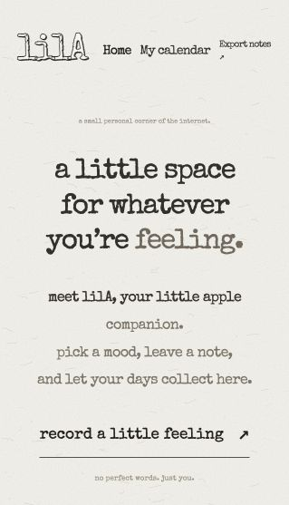

# lilA

A small English-language mood journal for SD5913 Assignment 3. The flow is Home → choose a feeling with the apple → write a sticky note → pin it to a calendar. Six moods are available: Calm, Teary, Happy, Grumpy, Anxious and Tired. Each has a character expression, selection sound, calendar stamp and melody.



## Who it is for

lilA is for students and others who want a brief, low-pressure daily check-in. A feeling can be saved without writing a long diary. Selecting a mood changes the apple, caption and sound; saving a note adds a matching stamp to its date, so the user can revisit and edit that moment. It is a personal reflection tool, not a mental-health assessment.

## Run

No build step, account or paid API is required. From this folder run:

```bash
python3 -m http.server 8000
```

Open http://localhost:8000. Stop the server with Ctrl+C. The typewriter font is bundled locally; no external font service is needed.

## Interaction loop

1. Choose Record my mood on the home page.
2. Select Calm, Teary, Happy, Grumpy, Anxious or Tired. Click the apple to explore the expressions. Its :3 bubble and Play melody button play a short tune; Sound off mutes playback.
3. Continue to the sticky-note editor. Choose a date and write up to 2,000 characters, or save a mood without text.
4. Pin the note to the calendar. Select a day to view its notes, and open a note to read, edit or delete it. Deletion requires confirmation.
5. Review the last seven days from Home. Use month arrows or Today to navigate the calendar.
6. Export notes downloads a JSON backup. Notes are stored in this browser's localStorage, with no account or cloud synchronization. Clearing site data or changing browser/origin can make records unavailable. JSON import is not currently implemented.

## Verification

Browser checks on 29 October 2026 verified the full Home → mood → note → calendar flow; correct mood/date assignment; persisted notes after reload; editing without duplicating the entry; and confirmed deletion of a temporary test note. Earlier browser checks verified the character interaction, playback state and mute. Current narrow-width screenshots were inspected; desktop layout is implemented with responsive CSS but has not yet been visually verified at a wide viewport. No claim of audio listening evaluation is made.

## Files

- `index.html`: English interface, layout, responsive styles and character clipping.
- `app.js`: character state, sound effects and melody playback.
- `journal.js`: page routing, calendar, local storage, editing, deletion and export.
- `journal.css`: responsive journal layout and sticky-note styles.
- `home.css`: text-only editorial home-page styles.
- `print.css` and `typewriter.css`: shared paper/ink design, local typewriter font, centered home, apple-shaped note editor and hand-drawn calendar.
- `assets/`: original expression images, speech-bubble cutout and synthesized WAV audio.
- `make_sounds.py` and `make_new_moods.py`: reproducible synthesized sound effects and melodies.
- `PROCESS.md`: design development, feedback, limitations and AI assistance.
- `music/`: experimental Strudel scores; these are development references and are not loaded by the website.

## Credits and limitations

The apple images were created with AI image generation and refined through the student's visual direction. The runtime speech bubble is an original SVG with the simple :3 emoticon; a supplied screenshot informed its visual direction. External visual references are discussed in PROCESS.md. Character images are 2D renders, not a rotatable 3D model. CSS clips their background and exterior shadows.

The website currently uses original synthesized sound effects and short piano-like arrangements generated through code. It does not contain the reference songs EASY LIFE or GATE FAILURE 8745, a Suno track, or the unapproved Strudel house drafts. The current tunes are synthesized tones, not recordings of acoustic piano.

The code and documentation were developed with Codex assistance. See PROCESS.md for the scope of assistance and remaining manual checks.

Typography: Special Elite by Astigmatic is bundled locally under the Apache 2.0 license (see assets/fonts/LICENSE-SpecialElite.txt). Original procedural SVG paper texture supplies the background grain.
